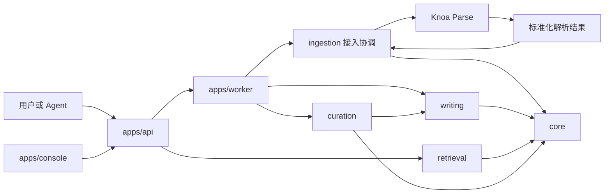

# 架构与边界

## 端到端路径

箭头表示调用或结果流向，不要求每条箭头都是网络请求。Parse 的 SDK 或服务调用方式尚未确定。任务基础设施也未选型。

## 依赖规则

| 模块 | 允许依赖的业务模块 | 主要职责与禁止事项 |
| --- | --- | --- |
| `core` | 无 | 空间、记忆、证据、版本、权限与存储接口；不依赖其他业务模块 |
| `ingestion` | `core`、版本化 Parse 契约/客户端 | 接收资料、发起解析、校验与导入证据；不形成记忆，不实现 OCR/ASR |
| `writing` | `core` | 价值判断、提取、冲突、纠偏、生成并提交语义变更 |
| `retrieval` | `core` | 检索、探索、证据组织、上下文预算；不修改权威记忆 |
| `curation` | `core`、`writing` | 整理计划、去重建议、关联、冷热策略；语义变更复用 writing |
| `apps/api`、`apps/worker` | 以上公开接口 | 认证接入、编排与任务执行；不积累业务算法 |
| `apps/console` | API 契约/客户端 | 浏览、搜索、证据、diff、修改、撤销与验证；不访问数据库 |
| `integrations` | 对外 HTTP/MCP 契约/客户端 | 适配宿主平台，不依赖引擎私有实现 |

数据库写入与权限约束集中在 core。writing 决定记忆如何变化，core 负责在授权和一致性规则下持久化。证据导入通过 core 专用接口，不能借此绕过 writing 修改记忆。

只导入模块公开接口；不得通过相对路径引用另一个模块内部文件。实现语言选定后增加依赖检查与循环依赖检测。目前检查工具**尚未**自动验证代码模块依赖。

## 双仓边界

Parse 只接收完成授权的解析输入和必要的任务上下文，不连接 Knoa 的权威业务数据库。Knoa 把外部 source 标识映射到受控空间，并在导入时重新验证来源与请求的对应关系；不信任解析结果自带的租户归属。

Parse 契约由 Parse 仓库维护。主仓保留一份有版本和摘要的契约快照，可以独立检出、验证和开发，无需访问相邻目录。升级步骤见 [契约说明](../contracts/README.md)。

## 数据与可靠性原则

- 原始资料版本与解析器版本可追踪；重新解析不静默覆盖旧证据引用。
- 记忆语义变更有版本和来源；撤销创建可审计的后续变更。
- 请求必须携带受认证的访问上下文，空间隔离不能仅靠检索后过滤。
- 任务重试不重复提交证据或记忆；具体幂等键、事务与重试策略待实现设计。
- 删除与权限收回需覆盖原始资料、证据、记忆、索引和派生结果；策略未定前不承诺保留期。
- 模型、存储、队列与解析后端通过接口替换，初期不为每种实现建立独立服务。

这些是设计约束，不能视为已实现的安全、隔离或性能保证。
